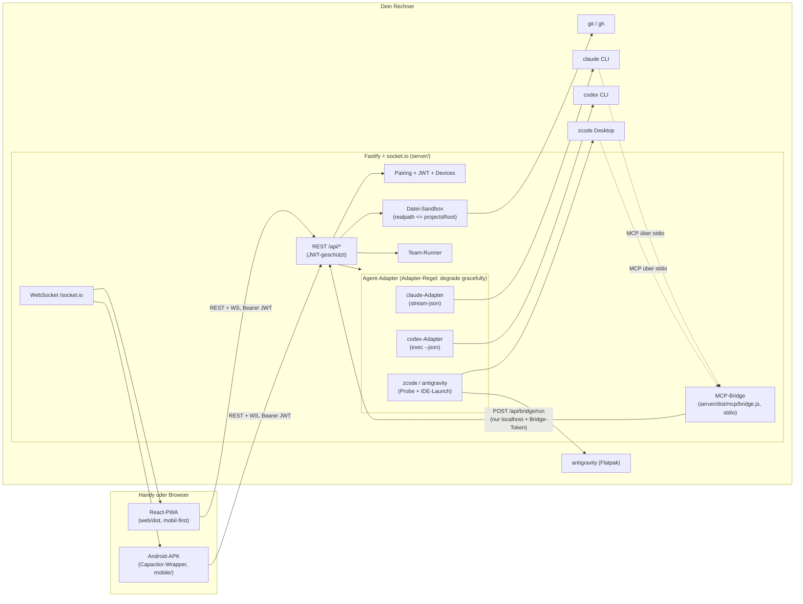
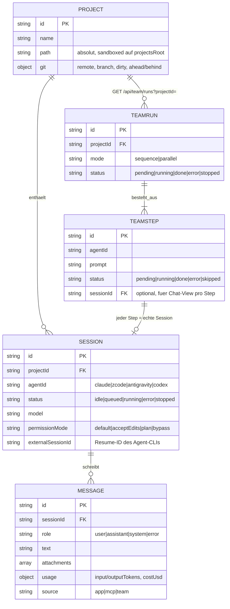
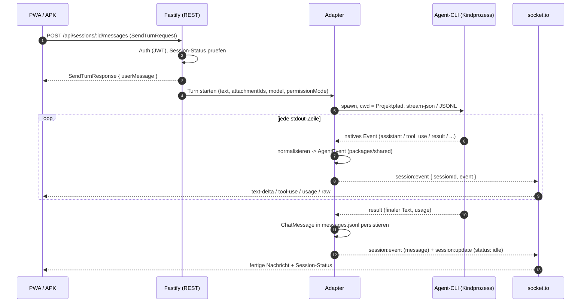
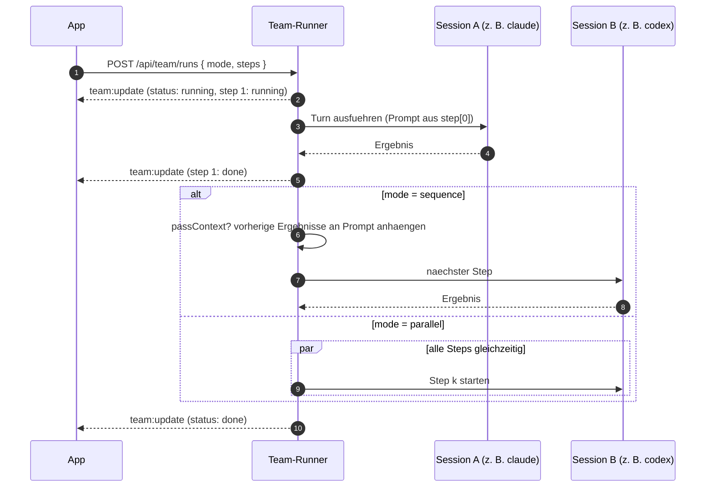
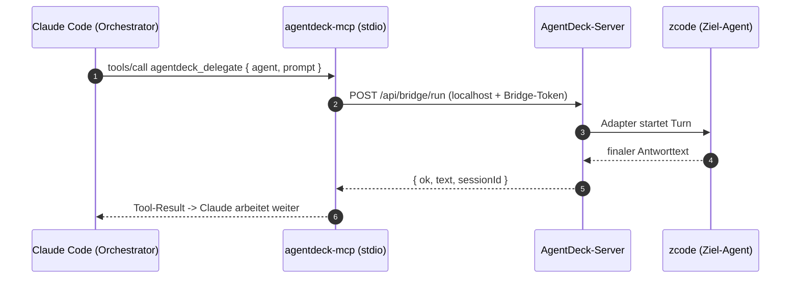

# Architektur

AgentDeck ist ein npm-Workspaces-Monorepo (ESM, Node ≥ 22). Der Server läuft
auf dem Rechner, auf dem auch die Agents arbeiten; die App (PWA oder APK) ist
ein dünner Client, der nur mit dem Server spricht — niemals direkt mit den
Agent-CLIs.

## Komponentenübersicht



**Adapter-Regel** (aus `docs/CONTRACT.md`): Jeder Adapter degradiert sanft.
`AgentInfo.available` spiegelt den Installationsstatus, `capabilities.headless`
die tatsächliche Fernsteuerbarkeit. Ein Probe darf **nie** als Nebeneffekt eine
GUI öffnen.

## Datenmodell

Alle Typen liegen in `@agentdeck/shared` (`packages/shared/src/`) und sind die
einzige Wahrheit für API- und WS-Payloads.



## Lebenszyklus eines Turns

Ein Turn ist eine Nutzer-Nachricht plus die Antwort des Agents. Er läuft
asynchron; solange ein Turn aktiv ist, antwortet
`POST /api/sessions/:id/messages` mit **409**.



Nebenkanäle desselben Musters:

- **Interrupt:** Client emittiert `session:interrupt` (mit Ack); Server killt
  den Prozess (SIGINT → 3 s Schonfrist → SIGKILL).
- **Timeout:** `maxRunMs` (Standard 30 min) killt harte Läufer.
- **Resume:** `externalSessionId` der Session wird an `--resume` bzw.
  `codex exec resume` durchgereicht.

## WebSocket-Protokoll

socket.io unter `/socket.io`, Handshake mit `auth.token` (JWT). Events sind in
`packages/shared/src/events.ts` typisiert:

| Richtung | Event | Zweck |
|---|---|---|
| Server → Client | `session:event` | Live-`AgentEvent`-Stream einer Session; Events eines Runs tragen `run` + `seq`, passend zum `draft` aus `GET /api/sessions/:id` (Einstieg mitten im Run) |
| Server → Client | `session:update` | Session-Metadaten (Status, Modell, …) |
| Server → Client | `project:update` | Projekt geändert / Clone-Fortschritt |
| Server → Client | `agent:update` | Verfügbarkeit/Capabilities geändert |
| Server → Client | `team:update` | Team-Run-Fortschritt |
| Server → Client | `notify` | Toast (info/warn/error) |
| Client → Server | `session:interrupt` | Turn abbrechen (mit Ack) |

Jedes mutierende REST-Endpoint emittiert danach das passende WS-Update.

## Speicherlayout

Alles liegt unter `dataDir` (Standard `~/.local/share/agentdeck`, siehe
[CONFIG.md](CONFIG.md)):

```
~/.local/share/agentdeck/
├── projects.json                     # Projekt-Registry
├── devices.json                      # gepaarte Geräte
├── jwt-secret                        # HS256-Secret (0600)
├── bridge-token                      # Token für /api/bridge/run (0600)
├── pairing-code.txt                  # aktueller Pairing-Code
├── projects/                         # Standard-projectsRoot (Sandbox)
├── stats.sqlite                      # Aktivität: jeder Agent-Lauf + Abo-Limits im Zeitverlauf (node:sqlite)
├── sessions/<id>/meta.json           # Session-Metadaten
├── sessions/<id>/messages.jsonl      # Chat-Verlauf (append-only)
└── attachments/<sessionId>/<fileId>__<safe-name>
```

Der Chat-Verlauf ist damit dateibasiert und portabel; löschen einer Session
löscht `sessions/<id>/` samt Attachments.

## Team-Run-Ablauf

`POST /api/team/runs` erzeugt einen `TeamRun`; **jeder Step wird eine echte
Session** — der Verlauf jedes Steps bleibt also im Chat browsable.



Semantik: `sequence` + `passContext: true` prependet die Ergebnisse der
vorherigen Steps jedem Prompt (Kette: „implementiere → reviewe → fixe").
`parallel` startet alle Steps gleichzeitig — sinnvoll für vergleichende Aufgaben.
Fehler in einem Step markieren den Run als `error`; ein `sequence`-Run bricht
ab, ein `parallel`-Run lässt die übrigen Steps laufen.

## MCP-Bridge-Schleife (Cross-Agent-Subagents)

Die Bridge ist ein eigener stdio-Prozess, den beliebige Agent-CLIs als
MCP-Server registrieren. Damit ruft z. B. Claude Code ZCode auf — Details in
[MCP-BRIDGE.md](MCP-BRIDGE.md).



Die erzeugten Sessions erscheinen mit `source: "mcp"` im Verlauf und sind
normal in der App sichtbar.
