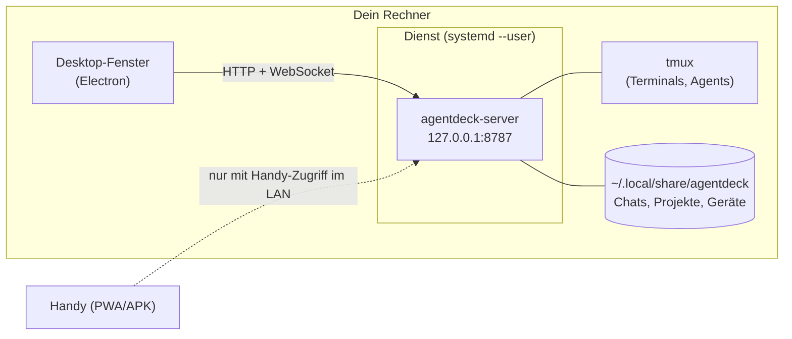

# Desktop-App (Linux)

AgentDeck gibt es auch als Desktop-App für Linux (Ubuntu, Bazzite und andere).
Sie besteht aus zwei getrennten Teilen, die du einzeln oder zusammen nutzt:

- **Der Dienst** (`agentdeck-server`): derselbe Server wie bisher, hier mit
  eigenem Node und tmux. Er läuft unsichtbar im Hintergrund (systemd-User-Dienst)
  und braucht kein Fenster.
- **Das Fenster** (die Desktop-App): ein Electron-Fenster auf diesen Server.
  Es hat **keinen eigenen Zustand** — Chats, Terminals, Projekte und Routinen
  liegen im Server. Handy und Desktop sehen deshalb immer dasselbe.



Das Fenster zu schließen beendet also weder Chats noch Terminals. Was beim
Schließen mit dem Dienst passiert, entscheidest du (siehe
[Schließen](#schließen)).

## Installation

Die Pakete hängen am jeweiligen [GitHub-Release](https://github.com/Ninjalama1337/agentdeck/releases)
(`AgentDeck-<version>-linux-x64.AppImage` und `.deb`). Es wird nichts ins System
installiert außer dem Paket selbst; Dienst, Laufzeit und Daten liegen in `$HOME`.

### Ubuntu 22.04 / 24.04 — `.deb` (empfohlen)

```bash
sudo apt install ./AgentDeck-*.deb
```

Das Paket richtet auch ein AppArmor-Profil ein. Ubuntu 24.04 sperrt
Benutzer-Namensräume für Programme ohne Profil, und ohne sie startet Chromiums
Sandbox nicht.

### AppImage (Ubuntu, Bazzite und andere)

```bash
chmod +x AgentDeck-*.AppImage
./AgentDeck-*.AppImage
```

- **Ubuntu 22.10+** bringt `libfuse2` nicht mit: `sudo apt install libfuse2t64`
  (24.04; unter 22.04 `libfuse2`).
- **Ubuntu 24.04** braucht für das AppImage ein AppArmor-Profil (siehe
  [Fehlerbehebung](#fehlerbehebung)) — oder nimm das `.deb`.
- **Bazzite** (unveränderliches System): Das AppImage läuft direkt, einbinden
  lässt es sich mit *Gear Lever* aus dem App-Store. Flatpak passt nicht, weil
  AgentDeck Shells, Agent-CLIs, tmux und `systemctl --user` auf dem Host
  braucht; `rpm-ostree`-Layering ist nicht nötig. Auf Bazzite habe ich die App
  nicht ausprobiert — bitte beim ersten Start melden, falls etwas hakt.

## Erster Start

1. Die App sucht auf `127.0.0.1:8787` nach einem AgentDeck-Server (eine
   vorhandene Checkout-Installation wird einfach genutzt).
2. Findet sie keinen, fragt sie **„Als Hintergrunddienst einrichten?“**.
   - *Als Dienst einrichten*: legt die Laufzeit unter
     `~/.local/share/agentdeck/runtime/<version>/` an, schreibt
     `~/.config/systemd/user/agentdeck.service` und startet ihn. Er läuft ab
     dann bei jedem Login, auch ohne Fenster.
   - *Ohne Dienst starten*: Die App startet den Server losgelöst vom Fenster
     (er überlebt das Schließen), aber nicht den nächsten Login.
3. Das Gerät wird automatisch gepairt (die App liest den Pairing-Code aus
   `pairing-code.txt` im Datenordner); du tippst nichts ein.

Der **Port ist fest** (8787, oder `port` in `~/.config/agentdeck/config.json`).
Antwortet dort ein anderes Programm, weicht die App nicht aus, sondern sagt es
dir — die Anmeldung im Fenster hängt an der Adresse. Ein fremdes Programm auf dem
Port bekommt weder die Fenster-Bridge noch den Pairing-Code: Beides gibt es nur
für einen Server, der sich auf `/api/health` als AgentDeck meldet.

## Schließen

Beim Schließen des Fensters erscheint (Standard) ein Dialog:

| Button | Wirkung |
|---|---|
| **Im Hintergrund weiterlaufen** (Standard) | Fenster zu, Dienst läuft weiter. Agenten, Routinen und Benachrichtigungen laufen weiter; das Handy bleibt verbunden, wenn „Handy-Zugriff im LAN“ an ist. |
| **Dienst stoppen und beenden** | Der Server hält an; laufende Agent-Läufe werden unterbrochen. **Terminals laufen in tmux weiter** und sind nach dem nächsten Start wieder da. |
| **Abbrechen** | Das Fenster bleibt offen. |

Der Dialog nennt, wie viele Agent-Läufe und Terminals gerade aktiv sind, und
hat die Checkbox **„Nicht mehr fragen“**. Die Wahl lässt sich jederzeit unter
*Settings → Desktop app → Closing the window* ändern (*Ask*, *Keep running*,
*Stop and quit*). Läuft der Server nicht unter der Kontrolle der App (z. B. aus
einem Checkout gestartet), gibt es nur „Beenden“, nie „Dienst stoppen“.

## Genau so wie geschlossen

| Was | Wo es bleibt |
|---|---|
| Chats, Verlauf, Projekte, Routinen, Aktivität | Server (`~/.local/share/agentdeck`) — atomar geschrieben |
| Terminals samt Bildschirm | tmux; beim Start hängt sich der Server wieder an. Nur ein Neustart des Rechners oder Logout beendet sie |
| Geöffnetes Fenster: Tab, Chat, Terminals, Projekt | localStorage des Fensters, **pro Server** (`agentdeck:route`, `:session`, `:panes`); wird beim Start ohne Hash-Adresse wiederhergestellt. Gelöschte Chats/Projekte fallen sauber auf die Liste bzw. Home zurück |
| Entwürfe, Einstellungen, Anmeldung | localStorage des Fensters (`~/.config/agentdeck-desktop/`) |
| Fenstergröße, -position, maximiert | `~/.config/agentdeck-desktop/window-state.json` |

Nicht erhalten bleibt, was ein Prozess im Speicher hält: ein **gerade laufender
Chat-Turn** endet, wenn der Dienst gestoppt wird (nach dem Start steht er auf
*idle*, mit Hinweis im Chat). Scroll-Position und offene Dialoge werden nicht
gespeichert. Terminals gehen bei Reboot und Logout verloren — die Agent-Sitzung
setzt du mit *Weiter* fort.

Auch wenn tmux nach einem Wechsel zwischen Checkout- und Paket-Server die Sitzungen
nicht ansprechen kann (unterschiedliche tmux-Versionen), löscht der Server die
Terminal-Einträge nicht: Er behält sie, meldet es laut im Log und hängt sich
wieder an, sobald ein passendes tmux läuft. Ungültige Sitzungen entfernt er erst,
wenn tmux eindeutig sagt, dass es sie nicht (mehr) gibt.

Wird die Anmeldung des Fensters ungültig (z. B. Server-Daten zurückgesetzt), pairt
es sich still neu und behält dabei Ansicht, Chat, Projekt und Panes.

## Einstellungen

*Settings → Desktop app* erscheint nur im Desktop-Fenster:

- **Closing the window** — *Ask*, *Keep running*, *Stop and quit*.
- **Start at login** — legt `~/.config/autostart/agentdeck.desktop` an
  (`--hidden`: stellt nur den Dienst sicher, kein Fenster).
- **Phone access in the local network** — Standard **aus**: der Server hört nur
  auf `127.0.0.1`. An: `0.0.0.0`, damit das Handy im WLAN pairen kann. Die
  Änderung installiert den Dienst neu und startet ihn neu (Terminals laufen in
  tmux weiter). Im LAN genügt der Pairing-Code ([SECURITY.md](SECURITY.md)) —
  lass es in fremden Netzen aus.
- **Service** — Status (Modus, Version, Adresse) und *Start*, *Restart*,
  *Stop*, *Install*, *Uninstall* (Daten bleiben).

Der angezeigte Host ist die tatsächliche Bindung (`127.0.0.1` oder `0.0.0.0`).
Bei einem Server, den die App nicht gestartet hat (**external**, oder eine Unit,
die nicht von `agentdeck-server` stammt), ist der LAN-Schalter deaktiviert: Dort
ändert man es dort, wo man den Server startet.

Modus des Servers: **service** (systemd-Unit läuft), **detached** (von der App
gestartet), **external** (läuft anderswo, die App verbindet sich nur),
**stopped**.

## Dienst ohne Fenster

Der Dienst funktioniert allein, z. B. auf einem Rechner ohne Oberfläche. Das
Paket enthält die CLI `agentdeck-server` (im AppImage unter
`resources/server/bin/`, im `.deb` unter `/opt/AgentDeck/resources/server/bin/`):

```bash
agentdeck-server service install [--lan] [--port N]
agentdeck-server service status --json
agentdeck-server service stop | start | restart
agentdeck-server service uninstall
agentdeck-server info --json
```

Weitere Details und die Unit-Eigenschaften: [CONFIG.md](CONFIG.md#dienst-ohne-checkout-agentdeck-server-service).
`loginctl enable-linger "$USER"` startet den Dienst schon beim Booten statt
beim Login.

## Desktop-Layout

Ab **1024 px Breite mit Maus/Touchpad** (`(pointer: fine)`) wechselt die
Oberfläche im Browser auf das Desktop-Layout. Im Desktop-Fenster gilt es schon ab
**640 px**, damit Zoomen (`Strg +`) das Fenster nicht ins Handy-Layout kippt. Kleiner und auf
dem Handy bleibt alles wie bisher.

- Seitenleiste statt Tab-Leiste (Projekt, Tabs mit Hinweisen, Verbrauch,
  Server-Wechsel, Verbindung, Inbox, Settings).
- Chats: Liste links, Unterhaltung rechts.
- Code: **1–4 Terminals nebeneinander** (3 = ein hohes und zwei gestapelte); pro
  Pane ein Terminal, ein Terminal gehört zu höchstens einem Pane.
- Home, Settings, Git, Files nutzen die Breite; Dialoge erscheinen zentriert.

| Kürzel | Wirkung |
|---|---|
| `Strg/Cmd + 1…5` | Home, Chats, Code, Git, Files |
| `Strg/Cmd + ,` | Settings |
| `Strg/Cmd + K` | Projektwechsler (nicht im Terminal, dort ist es „Zeile löschen“) |

`Strg + 1…5` gelten bewusst auch im Terminal (xterm würde `Strg + 2…5` sonst als
NUL/ESC/FS/GS senden). Ein Pane, das du bewusst leerst, bleibt leer, bis ein neues
Terminal gestartet oder eines zugewiesen wird.

Kleine Verhaltensänderungen durch das Desktop-Layout und die Wiederherstellung:
„Enter sendet“ im Chat ist im Desktop-Layout ohne eigene Einstellung
voreingestellt; „Compose bar“ hat in den Desktop-Panes keine Wirkung; die App
startet — auch auf Handy, PWA und APK — auf der zuletzt genutzten Ansicht statt auf
Home, und der gewählte Terminal wird gemerkt; beim Serverwechsel öffnet der neue
Server seine eigene letzte Ansicht.

## Updates

- **App:** Die App aktualisiert sich selbst (`electron-updater`, nur gepackt).
  Beim Start prüft sie das neueste Release, fragt (Herunterladen & installieren /
  Später / Diese Version ignorieren), lädt und bietet den Neustart an.
  **AppImage:** das neue AppImage ersetzt das alte an seiner Stelle (Delta-Update,
  kein Passwort). **deb:** das Paket wird über die Paketverwaltung installiert
  (pkexec/sudo-Prompt). Das geht nur, solange die Releases ohne Anmeldung lesbar
  sind: Ist das Repository privat, findet der Updater kein Release — dann das neue
  `.deb` mit `sudo apt install ./…` einspielen bzw. das AppImage austauschen.
- **Dienst:** Beim ersten Start der neuen App erkennt sie, dass die installierte
  Laufzeit älter ist als die mitgelieferte, kopiert die neue
  (`runtime/current` zeigt darauf; die letzten zwei Versionen bleiben) und startet den
  Dienst neu — **ohne Rückfrage**; laufende Agent-Läufe werden dabei unterbrochen,
  Terminals laufen in tmux weiter. Ein von der App losgelöst gestarteter Server
  (ohne Dienst) wird nicht automatisch auf die neue Version gebracht.
- Ein Dienst aus dem Paket aktualisiert sich **nicht** über *Settings → Server
  update* oder `scripts/update.sh` (kein Git-Checkout); die App zeigt dort den
  Grund. Ein Checkout-Server funktioniert wie bisher ([RELEASES.md](RELEASES.md)).
- tmux: Die mitgelieferte Version (3.6a) spricht mit Servern gleicher
  Protokollversion. Ein Sprung der Protokollversion würde laufende Terminals
  bis zu ihrem Ende unerreichbar machen — deshalb ist die Version gepinnt.

## Dateien und Pfade

| Pfad | Inhalt |
|---|---|
| `~/.local/share/agentdeck/` | Daten des Servers (wie bisher, [CONFIG.md](CONFIG.md)) |
| `~/.local/share/agentdeck/runtime/<version>/`, `runtime/current` | Kopie des Server-Bundles, die die Unit startet |
| `~/.config/systemd/user/agentdeck.service` | die Unit (erste Zeile `# Managed by agentdeck-server`) |
| `~/.config/agentdeck/config.json` | Konfiguration des Servers (wie bisher) |
| `~/.config/agentdeck-desktop/` | Fenster: `settings.json`, `window-state.json`, Browser-Profil |
| `~/.config/autostart/agentdeck.desktop` | Start beim Login |
| `~/.local/state/agentdeck/server.log`, `desktop.log` | Logs (Dienst: `journalctl --user -u agentdeck`) |

Deinstallieren: *Settings → Service → Uninstall* (oder
`agentdeck-server service uninstall`), dann das Paket entfernen. Die Daten unter
`~/.local/share/agentdeck/` bleiben, bis du sie selbst löschst.

## Selber bauen

```bash
npm ci
AGENTDECK_BUNDLE_TMUX=1 scripts/build-server-bundle.sh   # → dist-bundle/agentdeck-server/ (CI: =required)
cd desktop
npm ci                       # eigenes Projekt, nicht Teil der Root-Workspaces
npm run typecheck && npm test
npm run dist                 # → desktop/release/ (AppImage + deb)
```

`scripts/build-server-bundle.sh` lädt Node 22 von nodejs.org (SHA256-geprüft),
baut `node-pty` gegen genau dieses Node und mit `AGENTDECK_BUNDLE_TMUX=1` ein
statisches tmux (`bison` wird dafür gebraucht; `=required` bricht ab, wenn es
nicht entsteht — so läuft es in CI). Die Prüfsummen von Node und der tmux-Quellen
sind im Skript festgeschrieben; die Lizenztexte von tmux, libevent und ncurses
liegen im Bundle unter `licenses/`. Umgebungsvariablen stehen im
Kopf des Skripts. `desktop/` ist ein eigenes npm-Projekt, damit
`npm ci` für den Server (CI, `scripts/update.sh`) kein Electron lädt. CI und
Release: [RELEASES.md](RELEASES.md#desktop-pakete).

## Fehlerbehebung

- **„Chromium-Sandbox kann nicht starten“ (AppImage, Ubuntu 24.04+):** Nimm das
  `.deb` oder lege einmalig als root ein Profil an
  (`/etc/apparmor.d/agentdeck-appimage` mit `userns,`; der genaue Text steht in der
  Meldung der App) und `sudo systemctl reload apparmor`. Notlösung:
  `AGENTDECK_NO_SANDBOX=1 ./AgentDeck-*.AppImage` — ohne Sandbox, unsicherer.
- **AppImage startet nicht, Meldung zu FUSE:** `sudo apt install libfuse2t64`, oder
  `./AgentDeck-*.AppImage --appimage-extract-and-run`.
- **„Port 8787 ist belegt“:** Ein anderes Programm hört dort. Beende es oder
  setze `port` in `~/.config/agentdeck/config.json`. Antwortet dort ein Programm
  nur sehr langsam, sagt die App „antwortet nicht“ mit „Erneut versuchen“.
- **Der Pairing-Code vom Handy ist ungültig:** Der Code rotiert nach jeder
  Verwendung — also auch, wenn sich das Desktop-Fenster pairt. Den aktuellen Code
  zeigt *Settings → Paired devices*.
- **Dienst startet nicht:** `agentdeck-server service status --json`,
  `journalctl --user -u agentdeck -e`. Läuft noch ein von der App losgelöst
  gestarteter Server, verweigern `service install`/`start` mit Hinweis — erst
  beenden (App: *Stop*).
- **Eigene Unit aus dem Checkout:** `service install` überschreibt sie nicht ohne
  `--force`.
- **Terminals fehlen nach einem Neustart des Rechners:** erwartet — tmux endet
  mit der Sitzung; die Agent-Sitzung mit *Weiter* fortsetzen.

## Was nicht geprüft ist

Entwickelt und getestet wurde in einem Container ohne Desktop und ohne echten
systemd-User-Manager. Per Test abgedeckt sind die Logik von Server-CLI und
Desktop-Shell (gegen ein Fake-`systemctl`), das Bundle (Start, `node-pty`,
tmux, Pairing) und das Desktop-Layout im Browser. **Nicht** auf echter
Hardware geprüft: der Dienst unter echtem systemd, das fertige AppImage/deb auf
Ubuntu 24.04 und Bazzite (CI baut auf `ubuntu-22.04`), das AppArmor-Profil, der
Autostart, Mehr-Monitor-Fenstergeometrie. Bitte beim ersten Einsatz darauf
achten und Auffälligkeiten melden.
