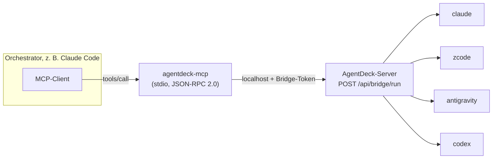

# MCP-Bridge — Cross-Agent-Subagents

Die Bridge macht aus vier getrennten Agent-CLIs ein Team: Sie ist ein
standalone **stdio-MCP-Server** (`server/dist/mcp/bridge.js`, bin des
`server`-Pakets, handgeschriebenes JSON-RPC 2.0 — keine SDK-Abhängigkeit).
Registriere sie bei einem Agent, und dieser Agent kann jeden anderen Agent
auf derselben Maschine als Subagent aufrufen.

## Konzept



- Der Orchestrator (z. B. Claude Code) startet die Bridge als Kindprozess und
  spricht JSON-RPC über stdio.
- Die Bridge ruft `POST /api/bridge/run` auf dem **lokalen** AgentDeck-Server
  auf (nur localhost + Bridge-Token, siehe [SECURITY.md](SECURITY.md)).
- Der Server führt den Turn über den normalen Adapter des Ziel-Agents aus.
- Das Ergebnis ist der finale Antworttext des Ziel-Agents — zurück im Chat des
  Orchestrators.
- Jede Delegation erzeugt eine echte **Session** mit `source: "mcp"`: Verlauf
  browsable, Proc-Kill/Timeout/Resume wie bei App-Turns.

Damit funktioniert „Lass zcode das Review machen“ nicht als Metapher, sondern
als echter Tool-Call.

## Tools-Referenz

### `agentdeck_list_agents`

Verfügbare Agents + Capabilities. Keine Argumente.

```json
{ "name": "agentdeck_list_agents", "arguments": {} }
```

Ergebnis (Ausschnitt):

```json
{
  "agents": [
    { "id": "claude", "available": true, "headless": true },
    { "id": "zcode", "available": true, "headless": false, "reason": "ide-only" },
    { "id": "codex", "available": true, "headless": true }
  ]
}
```

Sinnvoll als erster Schritt: Der Orchestrator sieht, wen er delegieren kann.

### `agentdeck_delegate`

Führt einen Turn auf dem Ziel-Agent aus und liefert den finalen Text zurück.

```json
{
  "name": "agentdeck_delegate",
  "arguments": {
    "agent": "codex",
    "prompt": "Fasse die Änderungen in src/api.ts in 3 Bullet Points zusammen.",
    "project": "agentdeck",
    "model": "gpt-5.1-codex",
    "timeoutMs": 300000
  }
}
```

| Feld | Pflicht | Bedeutung |
|---|---|---|
| `agent` | ja | Ziel-Agent: `claude`, `zcode`, `antigravity`, `codex` |
| `prompt` | ja | Der Turn-Text |
| `project` | nein | Projektname (Registry) oder absoluter Pfad; ohne Angabe: erster/Standard |
| `model` | nein | Modell-Override für diesen Turn |
| `timeoutMs` | nein | Eigenes Limit für den Aufruf (Server-seitig gilt zusätzlich `maxRunMs`) |

Ergebnis:

```json
{ "ok": true, "text": "…", "sessionId": "s_01J…" }
```

Bei Fehler: `{ "ok": false, "error": "…" }` (z. B. Agent nicht headless-fähig,
kein Projekt gefunden, Timeout).

### `agentdeck_project_files`

Dateilisting aus der Sandbox.

```json
{
  "name": "agentdeck_project_files",
  "arguments": { "project": "agentdeck", "path": "packages/shared/src" }
}
```

Ergebnis: Liste von `FileEntry` (`name`, `path`, `kind`, `size`, …) —
identisch zu `GET /api/projects/:id/files`. Nützlich, damit der Orchestrator
vor dem Delegieren prüft, was überhaupt existiert.

## Registrierung

Voraussetzung: AgentDeck-Server läuft (`npm start`, Standard
`http://127.0.0.1:8787`). Pfade sind absolut anzugeben.

### Claude Code

```bash
claude mcp add agentdeck -- /absoluter/pfad/zu/agentdeck/server/dist/mcp/bridge.js
```

Mit expliziter Server-URL:

```bash
AGENTDECK_URL=http://127.0.0.1:8787 \
  claude mcp add agentdeck -- node /absoluter/pfad/zu/agentdeck/server/dist/mcp/bridge.js
```

### ZCode (JSON-Konfiguration)

```json
{
  "mcpServers": {
    "agentdeck": {
      "command": "node",
      "args": ["/absoluter/pfad/zu/agentdeck/server/dist/mcp/bridge.js"],
      "env": { "AGENTDECK_URL": "http://127.0.0.1:8787" }
    }
  }
}
```

### Antigravity (JSON-Konfiguration)

Identisch zu ZCode:

```json
{
  "mcpServers": {
    "agentdeck": {
      "command": "node",
      "args": ["/absoluter/pfad/zu/agentdeck/server/dist/mcp/bridge.js"],
      "env": { "AGENTDECK_URL": "http://127.0.0.1:8787" }
    }
  }
}
```

### Codex (`~/.codex/config.toml`)

```toml
[mcp_servers.agentdeck]
command = "node"
args = ["/absoluter/pfad/zu/agentdeck/server/dist/mcp/bridge.js"]
env = { "AGENTDECK_URL" = "http://127.0.0.1:8787" }
```

## Environment-Variablen der Bridge

| Variable | Default | Bedeutung |
|---|---|---|
| `AGENTDECK_URL` | `http://127.0.0.1:8787` | Adresse des AgentDeck-Servers |
| `AGENTDECK_BRIDGE_TOKEN` | — | Bridge-Token direkt setzen; ohne diese Variable liest die Bridge die Datei `<dataDir>/bridge-token` (deshalb funktioniert sie out-of-the-box auf demselben Rechner) |
| `AGENTDECK_DATA_DIR` | `~/.local/share/agentdeck` | Wo die Bridge nach `bridge-token` sucht (muss zur Server-Konfiguration passen) |

Beachte den Unterschied: `AGENTDECK_*`-Variablen konfigurieren den **Server**
(siehe [CONFIG.md](CONFIG.md)), die drei oben die **Bridge**.

## Beispiel-Szenario: Claude orchestriert, Codex reviewt

Wichtig vorab: **Delegation braucht einen headless-fähigen Ziel-Agent** — der
Ziel-Turn muss als Prozess laufen können. ZCode im `ide`-Modus kann selbst
Orchestrator sein (Bridge bei ZCode registrieren), aber nicht Ziel. Wer ZCode
als Ziel testen will, setzt in der Config `agents.zcode.mode = "headless"`
(experimentell, siehe [CONTRACT.md](CONTRACT.md) und [CONFIG.md](CONFIG.md)).

**a) Claude ↔ Codex (beide headless) — der reibungslose Fall:**

> Reviewe meinen Fix in `server/src/git.ts`. Lass danach codex mit
> `agentdeck_delegate` einen zweiten Blick darauf werfen, ob die
> Fehlerbehandlung bei nicht-existing branches stimmt. Nimm seine Hinweise
> ernst und fixe sie, bevor du committest.

Ablauf: Claude ruft `agentdeck_delegate { agent: "codex", prompt: "…" }` auf,
liest das Ergebnis, fixt und committet. Der Codex-Turn erscheint als eigene
Session mit `source: "mcp"` — im Handy-Chat nachlesbar.

**b) ZCode als Orchestrator (ZCode in der IDE, Agents headless):**

ZCode registriert die Bridge ebenfalls (JSON oben) und delegiert Fleißaufgaben
an `claude`/`codex`, während du im ZCode-Fenster arbeitest:

> Nutze agentdeck_delegate: lass claude die Tests für die neue Bridge-Route
> schreiben, während ich das UI-Layout fertig mache.

**Regeln für gute Delegation-Prompts** (der Ziel-Agent startet mit **keinem**
Kontext des Orchestrator-Chats):

1. Projekt und Pfade explizit nennen (`project`, Pfade im Prompt).
2. Erwartetes Ergebnis definieren („finale Antwort = Liste der Befunde").
3. `timeoutMs` setzen, wenn die Aufgabe langlaufen könnte.
