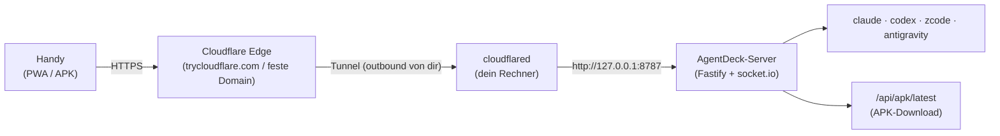

# Remote-Zugriff & APK-Verteilung

AgentDeck ist dafür gebaut, aus dem Heimnetz bedient zu werden — aber genau der
Witz ist, von **unterwegs** an seine Agents zu kommen. Dieses Dokument zeigt
die drei sauberen Wege dorthin und erklärt, wie die Android-APK automatisch
gebaut, verteilt und aktualisiert wird.

---

## Übersicht: drei Varianten

| | **Tailscale / WireGuard** | **Cloudflare Tunnel** | **Reverse Proxy + eigenes TLS** |
|---|---|---|---|
| Prinzip | Gerät-zu-Gerät-VPN, der Server bleibt im LAN | Outbound-Tunnel zu Cloudflare, öffentliche HTTPS-URL ohne Portfreigabe | Eigene Domain zeigt auf deinen Server (Portfreigabe oder Tunnel nötig) |
| Aufwand | niedrig (App installieren, anmelden, fertig) | niedrig bis mittel (Quick-Tunnel: 1 Zeile Config; Named Tunnel: cloudflared-Konto) | mittel bis hoch (DNS, Zertifikate, ggf. DynDNS, Portfreigabe) |
| Exposition | **kein öffentlicher Endpoint** — nur VPN-Mitglieder erreichen AgentDeck | ein öffentlicher HTTPS-Endpoint (nur die zwei öffentlichen APK-Routen + Pairing sind ohne JWT erreichbar) | öffentlicher Endpoint, komplett in deiner Hand |
| Eignung | **empfohlen**, wenn nur deine Geräte zugreifen sollen | ideal für unterwegs ohne VPN-Client und zum APK-Download aus fremden Netzen | wenn du ohnehin eine Domain mit TLS betreibtst (Caddy/Nginx-Beispiel: [SECURITY.md](SECURITY.md)) |

Alle drei Varianten enden am selben Server — die App verbindet sich einfach
mit einer anderen Adresse (in der App unter **Settings → API address**).

## Cloudflare Tunnel Schritt für Schritt

Der Server spricht bei aktivem Tunnel **selbst** mit Cloudflare (`cloudflared`
als Child-Prozess, outbound — keine Portfreigabe im Router). Status und URL
siehst du in der Konsole beim Start und in der App unter **Settings →
Remote access** (grün = verbunden, gelb = startet, rot = Fehler).

### a) Quick-Tunnel — ohne Konto, in 1 Minute

Voraussetzung: `cloudflared` installiert (z. B. `sudo apt install cloudflared`
oder [Binary-Release](https://developers.cloudflare.com/cloudflare-one/connections/connect-networks/downloads/)).
Dann entweder Env-Variable:

```bash
AGENTDECK_TUNNEL=cloudflared npm start
```

oder fest in `~/.config/agentdeck/config.json`:

```jsonc
{
  "tunnel": {
    "provider": "cloudflared",
    "mode": "quick"
  }
}
```

Beim Start verbindet sich AgentDeck und druckt die öffentliche URL
(`https://<zufall>.trycloudflare.com`) in die Konsole; `cloudflared` selbst
suchst du nicht per Hand zusammen. **Wichtig:** Die Quick-Tunnel-URL ist bei
jedem Start **zufällig** — nach einem Server-Neustart scannst du einfach den
**QR-Code in der Server-Konsole** (er öffnet die App gleich richtig
verdrahtet: `?server=…` setzt die Adresse automatisch, du gibst nur noch den
Pairing-Code ein). Dauerhaft Ruhe gibt Variante b).

### b) Feste URL — Named Tunnel (einmalig, danach nie wieder ändern)

Der Wechsel der Quick-Tunnel-URL entfällt komplett, wenn du einmalig einen
benannten Tunnel anlegst. Das übernimmt `scripts/setup-tunnel.sh` für dich:

```bash
scripts/setup-tunnel.sh
# führt dich durch: cloudflared login → Tunnel anlegen → DNS-Route → config.json
```

Voraussetzung: ein kostenloses Cloudflare-Konto mit einer dort verwalteten
Domain. Danach steht in `~/.config/agentdeck/config.json`:

```jsonc
{
  "tunnel": {
    "provider": "cloudflared",
    "mode": "named",
    "name": "agentdeck",
    "hostname": "agentdeck.deinedomain.de"
  }
}
```

Ab jetzt ist `https://agentdeck.deinedomain.de` **dauerhaft** die Adresse —
über Neustarts, Rebuilds und Updates hinweg. Auf dem Handy einmalig
`https://agentdeck.deinedomain.de/?server=https://agentdeck.deinedomain.de`
öffnen (oder QR scannen) — fertig, nie wieder tippen.

> **Alternative ohne Domain:** Tailscale (siehe Tabelle oben) — die Tailnet-IP
> (`http://100.x.y.z:8787` oder MagicDNS-Name) ändert sich ebenfalls nie.


Weitere Overrides per Env: `AGENTDECK_TUNNEL_TOKEN=<token>` (schaltet direkt
auf Modus `token`, s. u.) und `AGENTDECK_TUNNEL_BINARY=<pfad>`, wenn
`cloudflared` nicht auf dem PATH liegt. Deaktivieren:
`AGENTDECK_TUNNEL=off` oder `"provider": "off"` (Default).

### b) Named Tunnel — mit Konto, feste URL

Für eine Adresse, die sich nie ändert:

```bash
cloudflared tunnel login                        # Browser-Auth bei Cloudflare
cloudflared tunnel create agentdeck             # legt Tunnel + Credentials an
cloudflared tunnel route dns agentdeck deck.example.com   # DNS-Eintrag
```

Dann den **Tunnel-Token** (Cloudflare-Dashboard → Zero Trust → Networks →
Tunnels → *agentdeck* → Installieren zeigt ihn) in die Config:

```jsonc
{
  "tunnel": {
    "provider": "cloudflared",
    "mode": "token",
    "token": "<tunnel-token>",
    "hostname": "deck.example.com"   // optional, nur Anzeige in der UI
  }
}
```

Ab jetzt zeigt `https://deck.example.com` stabil auf deinen Rechner — und die
App-Adresse muss nie wieder angefasst werden.

### c) Optional: Cloudflare Access davor (zusätzliche Auth-Ebene)

Der Tunnel macht AgentDeck **erreichbar**, Cloudflare Access macht ihn
**exklusiv**. Du kannst in Cloudflare Zero Trust (Access → Applications →
Add application → Self-hosted) die eigene Domain schützen und als Policy
z. B. **Email-OTP** mit deiner Mail-Adresse hinterlegen. Dann baut jeder
Browser zuerst eine Cloudflare-Anmeldung auf (Einmal-Code per Mail), bevor
er überhaupt AgentDeck sieht. Das ist der günstigste Weg, den öffentlichen
Endpoint hart abzuschotten — insbesondere für die paarungsfreien Routen
(Pairing-Seite, APK-Download). Der WebSocket und die REST-Aufrufe der App
laufen durch dieselbe Access-Schutzzone (einmal pro Browser/Gerät freigeben).

## APK-Verteilung

Die App muss man nicht aus einem Store laden — der eigene Server liefert sie
selbst aus (`GET /api/apk/latest`, öffentlich aber gedrosselt; Metadaten unter
`GET /api/apk/info`). Der Download-Button sitzt an zwei Stellen: direkt auf
der **Pairing-Seite** („Android app"-Karte) und unter **Settings → Android
app**. Downloads laufen als schlichter `<a download>`-Link, damit Androids
Download-Manager ohne Header klarkommen — Chrome fragt dann beim ersten Mal,
ob die Installation aus **unbekannten Quellen** für den Browser erlaubt ist.

Zwei Wege, die APK auf den Server zu bekommen:

**1. CI lädt automatisch hoch (empfohlen).** Der Workflow
[`.github/workflows/android.yml`](../.github/workflows/android.yml) baut bei
jedem `v*`-Tag (und manuell per *Run workflow*) die APK und pushed sie an
deinen Server, sobald zwei Repo-Secrets gesetzt sind
(*Settings → Secrets and variables → Actions*):

| Secret | Inhalt |
|---|---|
| `AGENTDECK_URL` | Basis-URL deines Servers, z. B. `https://deck.example.com` |
| `AGENTDECK_BRIDGE_TOKEN` | Inhalt von `~/.local/share/agentdeck/bridge-token` |

Die Version wird automatisch gesetzt: Tag `v1.2.3` → `1.2.3` (Channel
`release`), sonst CI-Lauf → `0.1.<laufnummer>` (Channel `ci`). Zusätzlich
erscheint die APK bei Tags als GitHub Release.

**2. Lokal hochladen.** Nach einem eigenen Build
(`scripts/build-android.sh`, siehe [ANDROID.md](ANDROID.md)):

```bash
scripts/upload-apk.sh mobile/android/app/build/outputs/apk/debug/app-debug.apk 0.1.42
```

Das Skript liest den Bridge-Token standardmäßig aus
`~/.local/share/agentdeck/bridge-token` und nimmt als Server
`http://127.0.0.1:8787` an (`AGENTDECK_URL`/`AGENTDECK_BRIDGE_TOKEN`
überschreiben; `--help` zeigt alles). Grenze: pro APK gelten
`maxApkBytes` (Default 200 MB, siehe [CONFIG.md](CONFIG.md)).

## Auto-Update — wie es wirklich funktioniert

Ehrlich vorab: AgentDeck hat **keinen** In-Play-Store-Update-Mechanismus.
Zwei der drei Wege aktualisieren sich trotzdem von selbst:

- **PWA:** Der Service Worker holt die neueste UI automatisch vom Server —
  ein `npm run build -w web` auf dem Server genügt, alle Browser-Instanzen
  ziehen beim nächsten Laden die neue Version. Nichts zu tun.
- **APK:** Die eingebettete UI ist ein Snapshot. Beim Start fragt die App
  `GET /api/apk/info` ab und vergleicht die eigene, im Build eingebrannte
  Version (`VITE_AGENTDECK_APK_VERSION`) mit der auf dem Server. Ist die
  Server-Version neuer, erscheint das **Update-Banner** („Update available —
  v1.2.3“) mit Ein-Klick-Download. Die Installation selbst übernimmt Android:
  APK antippen → „App aktualisieren?“ bestätigen → fertig, Daten und Pairing
  bleiben. Voraussetzung: der Browser/Download-Manager durfte einmalig aus
  **unbekannten Quellen** installieren (fragt Android beim ersten Mal an).
  Weggetippen (×) blendet den Banner bis zur nächsten Version aus.

**Variante „remote UI" (optional):** Statt der eingebetteten UI kann die APK
immer direkt die vom Server ausgelieferte Web-UI laden. Dazu in
`mobile/capacitor.config.ts` unter `server` den Tunnel-Hostname eintragen:

```ts
server: { url: 'https://deck.example.com', androidScheme: 'https', cleartext: true }
```

| | eingebettete UI (Default) | remote UI (`server.url`) |
|---|---|---|
| Updates | Update-Banner + APK-Neuinstallation | sofort, mit dem Server |
| Offline / LAN ohne Tunnel | funktioniert (UI lokal, Server im LAN) | geht nicht — UI lädt nur über den Tunnel |
| Vertrauensmodell | Code liegt lokal im APK | Server liefert jederzeit beliebige UI aus |

Für die meisten Setups ist die eingebettete UI mit Update-Banner der bessere
Kompromiss; die remote UI ist bequem, wenn der Tunnel **immer** läuft.



## Security-Checkliste für öffentlichen Betrieb

Wenn der Tunnel (oder ein Proxy) AgentDeck ins Internet stellt:

- [ ] **Pairing-Code** ist 6-stellig und **rotiert nach jeder erfolgreichen
      Paarung**; es gibt maximal 5 Versuche pro IP / 10 Minuten. Code niemals
      in Screenshots/Bildern teilen.
- [ ] Nur `/api/health`, `/api/apk/info` und `/api/apk/latest` sind ohne JWT
      erreichbar — und der APK-Download ist **gedrosselt**. Alles andere
      verlangt das Geräte-JWT (30 Tage gültig).
- [ ] **Geräte-Widerruf** nutzen: unter Settings → *Paired devices* lassen
      sich verlorene/unverdächtige Geräte einzeln abmelden (JWT damit
      wirkungslos).
- [ ] **Keine Secrets im APK:** die App enthält keine Tokens — Pairing und
      Server-Adresse kommen zur Laufzeit; CI pusht Builds per Bridge-Token
      **vom CI-Rechner aus**, nie im Bundle.
- [ ] **Hartes Schutzlevel:** Cloudflare Access (oben, Variante c) vor die
      Domain legen — dann sieht nur deine Mail-Adresse überhaupt eine
      Login-Möglichkeit.
- [ ] **Server-Bindung prüfen:** hinter einem Tunnel reicht
      `"host": "127.0.0.1"` in der Config ([CONFIG.md](CONFIG.md)) — der
      Traffic kommt über cloudflared lokal rein, nichts muss am Router offen
      sein.
- [ ] **Vermeiden:** klassisches Port-Forwarding auf `0.0.0.0:8787` ohne TLS
      (Pairing-Code + JWT laufen sonst Klartext übers Netz), Cloudflare-Access
      zu überspringen **und** gleichzeitig `host: 0.0.0.0` zu setzen, und den
      Bridge-Token irgendwo zu committen (er gehört nur in CI-Secrets bzw.
      `dataDir/bridge-token`, 0600).

Die Grundlagen (Datei-Sandbox, signierte Download-Tokens, Hard-Kill) sind in
[SECURITY.md](SECURITY.md) beschrieben; die verbindlichen Routen und Limits
stehen im [Contract](CONTRACT.md).
