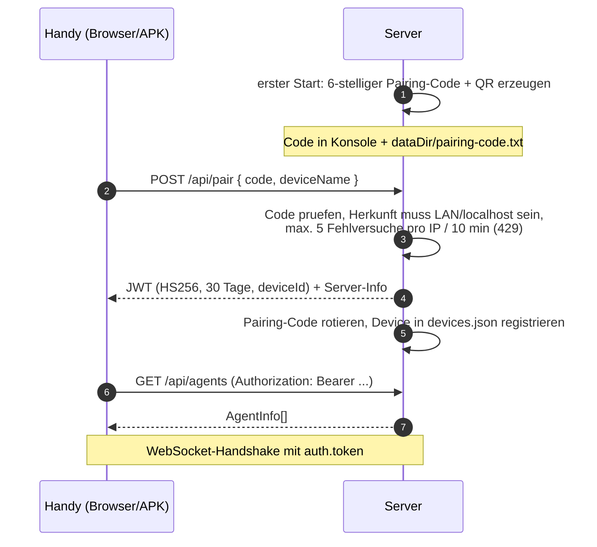

# Sicherheit

AgentDeck ist **self-hosted für eine Person**. Dieses Dokument sagt ehrlich,
was das System schützt, was es bewusst nicht schützt, und wie du es sicher
betreibst. Die verbindlichen Regeln stehen in
[`docs/CONTRACT.md`](CONTRACT.md) (Abschnitt *Auth & security*).

## Bedrohungsmodell — ehrlich

Schützende Annahme: Wer an deinem AgentDeck-Server sitzt, kann **Coding-Agents
mit deinem Login, deinem `gh`-Token und deinem Dateisystem starten**. Das ist
de facto volle Code-Ausführung auf deinem Rechner. Daraus folgt:

1. **Der Server ist kein Mehrbenutzer-System.** Es gibt genau einen Besitzer
   (du) und beliebig viele Geräte (deine Handys). Es gibt keine Rollen, keine
   Quoten, kein Audit-Log im Enterprise-Sinne.
2. **Die JWT ist der Schlüssel zum Rechner.** Wer sie hat, kann Agents starten,
   Dateien in `projectsRoot` lesen/hochladen und Git-Pushes auslösen. Deshalb:
   nur über LAN/VPN transportieren, Geräte verwalten, bei Verlust des Geräts
   sofort entfernen (App: Geräte-Liste) bzw. global invalidieren (siehe unten).
3. **Die Agents selbst sind die eigentliche Angriffsfläche.** Ein Agent, der
   einen bösartigen Prompt verarbeitet (z. B. via geklontem Repo), kann
   versuchen, Code auszuführen. AgentDeck knife’t das nicht ab —
   Permission-Modes (`default` statt `bypass`) und Verstand bleiben bei dir.
4. **Nicht geschützt:** Forensik, Malware-Schutz, Schutz vor dir selbst. Der
   Server verschlüsselt weder Daten-at-rest (`jwt-secret`, `bridge-token` sind
   Dateien mit `0600`) noch verhindert er, dass ein Agent auf sein eigenes
   Projektverzeichnis schreibend zugreift.

## Auth-Flow



Eigenschaften:

- `/api/health` ist die einzige Route ohne Auth (für Liveness-Checks).
- Pairing nur aus dem LAN bzw. localhost — ein Angreifer aus dem Internet kann
  selbst mit abgefangenem Code nichts paaren. Das gilt auch mit Tunnel oder
  Reverse Proxy: Anfragen, die ein lokaler Proxy für eine öffentliche Adresse
  weiterreicht (`X-Forwarded-For`, `CF-Connecting-IP` …), werden abgelehnt.
- Der Code **rotiert nach jeder erfolgreichen Paarung**; ein Code ist also
  maximal einmal brauchbar.
- Geräte-Liste in der App: einzelnes Gerät abmelden (`DELETE /api/devices/:id`).
- **Alle Geräte sofort abmelden:** `jwt-secret` aus `dataDir` löschen und den
  Server neu starten. Ohne gültige Signatur ist jede vorhandene JWT wertlos,
  alle Geräte müssen neu pairen.

## Warum Download-Tokens signiert sind

Android-Download-Manager (und „Teilen → in Datei speichern“) senden keine
`Authorization`-Header. Damit Downloads trotzdem nicht öffentlich werden,
signiert der Server eine begrenzte Erlaubnis statt den Inhalt freizugeben:

```
GET /api/projects/:id/files/raw?path=…&token=<base64url(payload)>.<hmac>
```

- `payload = { projectId, path, exp }`, signiert per **HMAC-SHA256** mit dem
  JWT-Secret, **TTL 120 Sekunden**.
- Der Token gilt für genau diesen Pfad in genau diesem Projekt — nicht
  übertragbar, nicht verlängerbar, nach 2 Minuten wertlos.

## Datei-Sandbox

- Jeder Pfad (Browser, Download, Upload-Ziel) wird mit `realpath` aufgelöst und
  muss innerhalb von `projectsRoot` enden — kein `../`-Traversal, kein
  Symlink-Escape nach außen.
- Uploads: Bilder und reguläre Dateien bis `maxUploadBytes` (Standard 20 MB),
  Dateinamen werden sanitisiert (`<fileId>__<safe-name>`).
- Der Server **löscht nie Projektdateien**: `DELETE /api/projects/:id` entfernt
  nur den Registry-Eintrag.

## Agent-Prozesse

- Agent-CLIs laufen mit `cwd = Projektpfad`, geerbter Umgebung, kein Shell-Mix
  durch User-Input aus der App.
- Kill-Kette bei Interrupt oder `maxRunMs`: SIGINT → 3 s Schonfrist → SIGKILL.
  Kein verwaister Prozess hält dein WLAN-Log voll.

## Bridge-Token

`POST /api/bridge/run` (die Schnittstelle der MCP-Bridge) akzeptiert nur
Aufrufer von **localhost** mit dem Token aus `dataDir/bridge-token` (Datei
`0600`, Token wird beim Serverstart in der Konsole angezeigt). Ein Agent kann
die Bridge also nur nutzen, wenn er ohnehin bereits lokal auf deinem Rechner
läuft.

## Betriebsempfehlungen

**1. Nur LAN oder VPN.** Der Normalfall: Server lauscht im Heimnetz
(`host: 0.0.0.0` oder LAN-IP), das Handy ist im selben WLAN. Noch besser:
[Tailscale](https://tailscale.com/) — dann ist der Server per
`AGENTDECK_HOST`-Bindung nur im VPN erreichbar und du hast überall Zugriff,
ohne irgendetwas freizugeben.

**2. Fernzugriff nur mit TLS.** Wenn du den Server übers Internet erreichbar
machst, niemals roh, sondern hinter einem TLS-Reverse-Proxy und an localhost
gebunden:

```bash
AGENTDECK_HOST=127.0.0.1 npm start
```

Caddy-Beispiel (`Caddyfile`) — automatisches HTTPS inklusive:

```
agentdeck.beispiel.de {
    reverse_proxy 127.0.0.1:8787
}
```

Danach im App-Profil die `https://`-Adresse eintragen. Ein Caddy auf dem
gleichen Rechner + localhost-Bindung bedeutet: Der Klartext verlässt die
Maschine nie unverschlüsselt.

**3. Pairing-Code geheim halten, aber entspannt.** Der Code ist kurzlebig
(Rotation nach jeder Paarung), nur LAN-paarbar und ratengeschützt. Trotzdem: Nicht in
Screenshots posten. Aktuellen Code jederzeit nachlesbar via
`dataDir/pairing-code.txt` oder Server-Konsole.

**4. Geräte hygienisch verwalten.** Verkauftes/verlorenes Gerät sofort in der
Geräte-Liste entfernen; im Zweifel `jwt-secret` löschen (siehe oben).

**5. Permission-Modes bewusst wählen.** `bypassPermissions` /
`--dangerously-skip-permissions` macht genau, was es sagt — praktisch für
langlaufende Refactorings, aber nur in Projekten einsetzen, deren Verlust du
verschmerzen könntest (und die unter Git stehen).

## Was du NICHT tun solltest

- **Port-Forwarding auf den Server ohne TLS** (Router/Firewall → `:8787`).
  Die JWT und dein Chat-Verlauf gingen im Klartext übers Internet.
- **Pairing-Code öffentlich teilen** (Screenshot in einen Chat/Bugreport).
- **Server als Root laufen lassen** — er braucht keine Privilegien; als
  systemd-User-Service reicht völlig (siehe [CONFIG.md](CONFIG.md)).
- **`projectsRoot` auf `$HOME` setzen.** Die Sandbox ist so stark wie ihr
  Root — zeige auf ein Verzeichnis mit Projekten, nicht auf dein Home.
- **Bridge-Token in Environment-Variablen von CI/CD oder Dotfiles committen.**
  Er liegt absichtlich als `0600`-Datei im `dataDir`.
